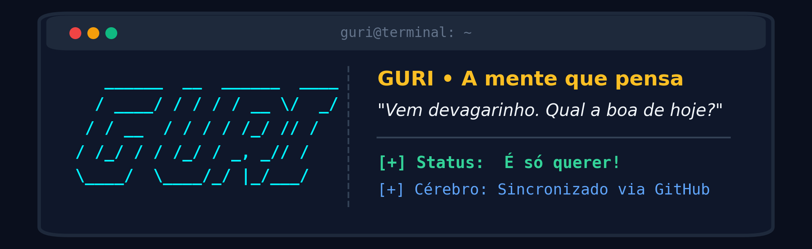

<p align="center">
  
</p>

<div align="center">

[](https://github.com/kauan-barcellos/Guri)
[](https://github.com/kauan-barcellos/Guri)
[](https://antigravity.google)
[](https://kicad.org)
[](https://python.org)

</div>

# Guri

Repositório central de configurações, habilidades e regras de trabalho do assistente Guri. Este diretório funciona como a memória persistente do agente no Antigravity CLI e pode ser clonado em qualquer máquina para manter o mesmo padrão de trabalho.

---

## O que está configurado aqui

O conteúdo é organizado em três pastas principais:

### 1. Regras permanentes (`rules/`)
Diretrizes ativas em todas as conversas e projetos:
* **`diretrizes-gerais.md`**: Linguagem direta em português do Brasil, sem termos rebuscados. Gráficos com 300 DPI, unidades físicas nos eixos e escalas comparáveis.
* **`seu-tom-de-voz.md`**: Regras anti-IA para textos e conversas (sem travessões artificiais, sem oposições correlativas, sem clichês corporativos e com autoridade baseada em fatos).
* **`analise-de-prompt-e-pesquisa.md`**: Análise e estruturação obrigatória de cada pedido antes da execução, além da escolha estratégica do padrão de busca na web.
* **`rotina-sync-encerramento.md`**: Rotina de verificação e envio automático das alterações para o GitHub antes de fechar a sessão.

### 2. Habilidades de trabalho (`skills/`)
Módulos carregados sob demanda pelo agente:
* **Engenharia de Prompt e Arquitetura:**
  * `prompt-dspy`: Estruturação declarativa de raciocínio (Input -> Thought -> Output) e otimização programática.
  * `prompt-promptfoo`: Testes automatizados, matrizes de asserções em YAML e prevenção de regressões e falhas de borda.
  * `prompt-fabric`: Padrões modulares de prompt (Fabric patterns) para desconstrução cirúrgica de tarefas humanas.
* **Pesquisa na Internet e Extração Web:**
  * `pesquisa-tavily`: Motor de busca contextual para RAG, respostas factuais diretas e contexto limpo sem ruído visual.
  * `pesquisa-firecrawl`: Raspagem exaustiva de documentações técnicas, páginas em JavaScript e PDFs em formato Markdown.
  * `pesquisa-brave`: Consultas velozes em índice global independente para mapeamento ágil de repositórios e links neutros.
* **Hardware e PCB (KiCad 10):**
  * `kicad10-hardware-design` e `kicad10-pcb-designer`: Criação de placas, roteamento e geração de arquivos para fabricação na JLCPCB.
  * `bom-lifecycle-auditor`: Consulta ao banco de 513 mil componentes da JLCPCB para escolher peças de linha básica e evitar custos extras de montagem.
  * `embedded-pinout-planner`: Planejamento de pinagem para microcontroladores (STM32, ESP32, RP2040).
  * `hardware-adr`: Modelos e registros de decisões de arquitetura de circuito.
* **Aquisição de Dados e Testes (DAQ):**
  * `leitor-catman`: Leitura de arquivos .BIN e .TST do software HBM catmanAP (amostragens a 19.200 Hz), decimação com média de bloco e cálculo de torque, impactos por minuto (IPM) e rebote.
  * `labjack-lua`: Scripts embarcados em Lua para a placa LabJack T7-PRO com controle de memória e registradores Modbus.
  * `electrical-panel-analyzer`: Leitura e extração de dados de diagramas e quadros elétricos.
* **Jurídico e Proteção de Dados:**
  * `advogado-especialista`: Suporte em direito civil, empresarial, trabalhista e contratos.
  * `lgpd-*`: Conjunto de 18 módulos para auditoria, mapeamento de dados (ROPA), relatórios de impacto (RIPD) e atendimento a titulares.
* **Visualização e Qualidade de Código:**
  * `matplotlib` e `geopandas`: Geração de gráficos técnicos em alta resolução e análise de dados espaciais.
  * `tdd-cycle-orchestrator` e `systematic-debugging`: Desenvolvimento orientado a testes e diagnóstico metódico de erros.
  * `guri-core`: Script de inicialização e banner do terminal com frases do dia.

---

## As 3 regras de hardware

Em qualquer projeto de circuito impresso, o Guri segue três critérios práticos:
1. **Módulos prontos:** Usar placas prontas comerciais (conversores DC-DC, transceivers RS485, ESP32) conectadas por barras de pinos. Evitar circuitos discretos complexos ao redor de chips avulsos.
2. **Ergonomia de montagem:** Bornes voltados para as bordas externas da placa, furos de fixação M3 nos quatro cantos, pontos de teste acessíveis para multímetro e serigrafia legível.
3. **Segregação de ruído:** Separar fisicamente a área de potência (alimentação, relés, motores) da área lógica e dos barramentos de comunicação (I2C, SPI, UART).

---

## Como usar o Guri

### 1. Em um computador novo (Primeira vez)
No PowerShell de uma nova máquina, clone o repositório e rode o instalador automático:
```powershell
git clone https://github.com/kauan-barcellos/Guri.git $HOME\.gemini\config
& "$HOME\.gemini\config\skills\guri-core\scripts\setup.ps1"
```
Esse comando configura os atalhos `guri` e `guri-salvar` no seu perfil do PowerShell.

### 2. No dia a dia (Iniciar sessão)
Vá até a pasta do seu projeto e digite:
```powershell
guri
```
O comando busca novidades no GitHub automaticamente (`git pull`), exibe o banner oficial e abre o assistente. Se quiser reconectar a uma sessão específica:
```powershell
guri -c <id-da-sessao>
```

### 3. Ao terminar o trabalho (Encerrar sessão)
Você pode escolher a forma mais prática:
* **Na conversa com o Guri:** Diga apenas *"vamos encerrar por hoje, pode salvar e sincronizar"*. O assistente revisa as alterações, faz o commit e envia tudo para o GitHub.
* **No terminal:** Digite `guri-salvar` para enviar qualquer atualização diretamente.
