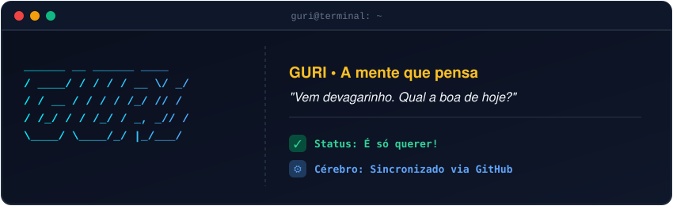

<p align="center">
  
</p>

<div align="center">

[](https://github.com/kauan-barcellos/Guri)
[](https://github.com/kauan-barcellos/Guri)
[](https://antigravity.google)
[](https://kicad.org)
[](https://python.org)

<p align="center">
  <b>O Segundo Cérebro portátil, versátil e descontraído para engenharia, dados, hardware e vida real.</b><br>
  <i>"Vem devagarinho. Qual a boa de hoje?"</i>
</p>

</div>

---

## 💡 O que é o Guri?

O **Guri** não é um assistente de IA comum cheio de respostas genéricas e bajulação. Ele é um parceiro de trabalho técnico, prático e polivalente, projetado para viver dentro do ecossistema **Google Antigravity** e ser transportado para qualquer computador (workstation de bancada, notebook de campo ou servidor) através deste repositório Git.

Ele pensa como engenheiro, resolve problemas com dados concretos e fala em português direto e autêntico — sem clichês corporativos, sem enrolação e sem travessões desnecessários.

---

## ⚡ Arsenal de Habilidades (O que o Guri sabe fazer)

O conhecimento do Guri é estritamente modular. Ele utiliza o mecanismo de *Progressive Disclosure*: carrega sob demanda apenas as ferramentas necessárias para a tarefa atual, economizando contexto e respondendo na velocidade da luz.

### 🛠️ 1. Engenharia de Hardware & PCBs (KiCad 10 + JLCPCB)
* **`kicad10-hardware-design` & `kicad10-pcb-designer`**: Fluxo profissional de criação de placas no KiCad 10 via MCP Server (batching de conexões, posicionamento automático, autoroteamento FreeRouting).
* **`bom-lifecycle-auditor`**: Consulta offline a uma base SQLite local com **513.000 componentes da JLCPCB**, priorizando peças *Basic* para eliminar taxas extras de montagem ($3/linha).
* **`embedded-pinout-planner`**: Planejamento e validação de pinagens de MCUs (STM32, ESP32, RP2040) prevenindo conflitos de periféricos e *strapping pins*.
* **`hardware-adr`**: Gestão e documentação de Registros de Decisão de Arquitetura de Hardware (ADRs).
* **`kicad-regime-classifier`**: Classificação de regimes elétricos e regras IPC-2152 (sinais rápidos, 3W e trilhas de potência).

> [!IMPORTANT]
> **As 3 Regras de Ouro de Hardware do Guri:**
> 1. **Módulos COTS:** Sempre priorizar o uso de módulos comerciais prontos (conversores DC-DC, transceivers RS485, etc.) em placas-mãe (*carrier boards*). Não desenhar circuitos discretos complexos sem necessidade.
> 2. **Ergonomia e Montagem:** Bornes voltados para fora, 4 furos M3 nos cantos, serigrafia nítida e Test Points de medição acessíveis.
> 3. **Segregação Física:** Isolar espacialmente o circuito de potência/relés dos sinais lógicos do microcontrolador e barramentos de comunicação.

---

### 📡 2. Aquisição de Dados (DAQ) & Instrumentação
* **`leitor-catman`**: Leitor de arquivos de aquisição de alta frequência (**19.200 Hz**) do software **HBM catmanEasy / catmanAP** (`.BIN` e `.TST`) via módulos QuantumX.
* **Filtro Anti-Aliasing**: Algoritmos de decimação por média de bloco para reduzir taxas sem perder os picos reais de choque e impacto.
* **Dinâmica de Ferramentas de Impacto**: Cálculo automatizado de torque máximo ($T_{max}$), média sustentada de impactos, cadência de golpes (**IPM**) e oscilação de rebote elástico.
* **`labjack-lua`**: Desenvolvimento de scripts embarcados em Lua de alta velocidade para DAQs **LabJack T7-PRO** (gestão de RAM < 25KB, precisão float 32-bit e timers de hardware).
* **`electrical-panel-analyzer`**: Análise e extração sistemática de diagramas e quadros elétricos a partir de imagens e PDFs.

---

### 🗣️ 3. Tom de Voz Autêntico & Regras Anti-IA (Permanente)
* **`seu-tom-de-voz`**: Método editorial completo para comunicação autêntica de liderança.
* **Diretriz Universal no Chat:** O Guri nunca usa respostas artificiais de IA ("Certamente!", "Com certeza!", "Com muito prazer!"). Ele entra direto na resolução.
* **Regras Anti-IA Universais:** Banimento de travessões desnecessários, proibições de oposição correlativa (*"não é X, é Y"*), eliminação de clichês vazios (*"game-changer", "robusto", "sinergia", "alavancar"*) e autoridade baseada em fatos e números reais.
* **`humanizer`**: Refinamento de textos corporativos para fluidez natural.

---

### ⚖️ 4. Jurídico & Compliance LGPD (Lei 13.709/2018)
* **`advogado-especialista`**: Assessoria multidisciplinar em Direito brasileiro (contratos, empresarial, civil, do consumidor e trabalhista).
* **Suite de 18 Habilidades LGPD**: Mapeamento de dados (`ropa`), relatórios de impacto (`ripd`), gestão de consentimento (`consent-schema`), requisições de titulares (`dsar`), resposta a incidentes, criptografia e conformidade de fornecedores.

---

### 📊 5. Visualização de Dados & Engenharia de Software
* **`matplotlib`**: Padrão de gráficos em alta resolução (**300 DPI**), eixos com unidades físicas obrigatórias, escalas verticais compartilhadas e picos destacados.
* **`geopandas`**: Manipulação e análise espacial de vetores e geodados.
* **Metodologia de Software**: `tdd-cycle-orchestrator` (Test-Driven Development), `systematic-debugging` (diagnóstico em 4 fases), `systematic-code-reviewer` e `token-optimization`.

---

## 📁 Estrutura do Repositório

```text
Guri/
├── assets/
│   └── banner.svg                 # Banner oficial do Guri renderizado em alta definição
├── README.md                      # Apresentação oficial e guia do cérebro
├── AGENTS.md                      # Instruções de comportamento e operação autônoma
├── .gitignore                     # Proteção contra logs, caches e arquivos de sessão
│
├── rules/                         # Diretrizes ativas em 100% das conversas
│   ├── diretrizes-gerais.md       # Voz simples em pt-BR, gráficos a 300 DPI e regras de hardware
│   ├── rotina-sync-encerramento.md# Protocolo obrigatório de salvar tudo antes de fechar
│   └── seu-tom-de-voz.md          # Regras anti-IA e postura de bancada
│
├── skills/                        # As 28 habilidades práticas modulares
│   ├── guri-core/                 # Identidade, frases aleatórias e banner do terminal
│   ├── kicad10-hardware-design/   # Metodologia de PCB, regras COTS e DFM JLCPCB
│   ├── kicad10-pcb-designer/      # Operações no KiCad 10 via MCP Server
│   ├── leitor-catman/             # Processamento de .BIN/.TST a 19.2 kHz
│   ├── labjack-lua/               # Scripts Lua para LabJack T7-PRO
│   ├── seu-tom-de-voz/            # Manual editorial e script validador anti-IA
│   ├── bom-lifecycle-auditor/     # Consulta à base local de 513k peças JLCPCB
│   ├── advogado-especialista/     # Consultoria jurídica geral
│   ├── lgpd-*/                    # 18 módulos de proteção de dados
│   └── ...                        # Outras ferramentas
│
└── plugins/                       # Extensões avançadas de refatoração e SDKs
```

---

## 🚀 Como usar o Guri em qualquer máquina

### 1. Clonar na máquina nova (Apenas uma vez)
Abra o terminal PowerShell e clone direto na pasta de configuração do Antigravity:
```powershell
git clone https://github.com/kauan-barcellos/Guri.git $HOME\.gemini\config
```

### 2. Ativar o comando `guri` no PowerShell
Adicione a função no seu perfil (`$PROFILE`) para iniciar com o banner oficial:
```powershell
function guri {
    python "$HOME\.gemini\config\skills\guri-core\scripts\banner.py"
    agy $args
}
```

### 3. No dia a dia de trabalho
* **Ao começar o dia:**
  ```powershell
  cd $HOME\.gemini\config; git pull origin main
  ```
* **Antes de encerrar a sessão:**
  ```powershell
  cd $HOME\.gemini\config; git add -A; git commit -m "Novos aprendizados"; git push origin main
  ```

---

<div align="center">

**GURI — A mente que pensa**<br>
<i>"Vem devagarinho. Qual a boa de hoje? É só querer!"</i>

</div>